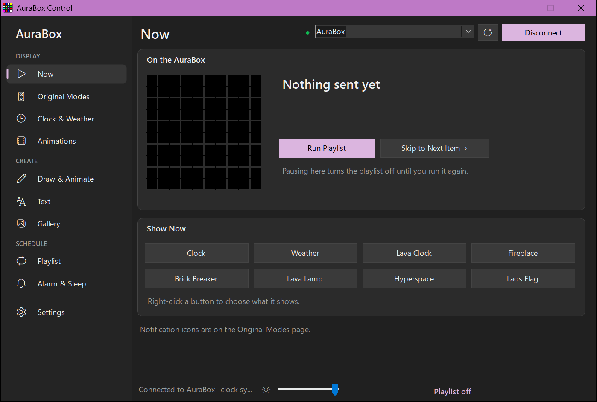
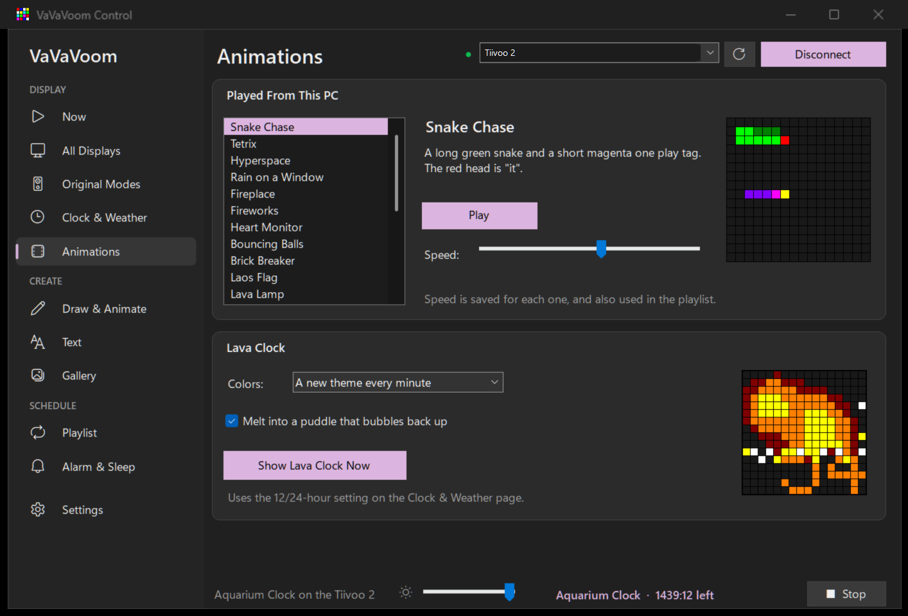
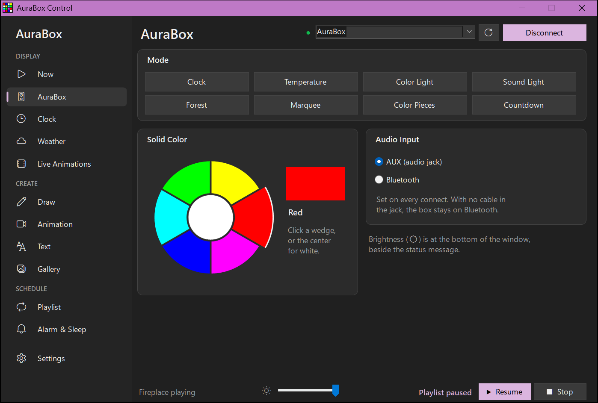
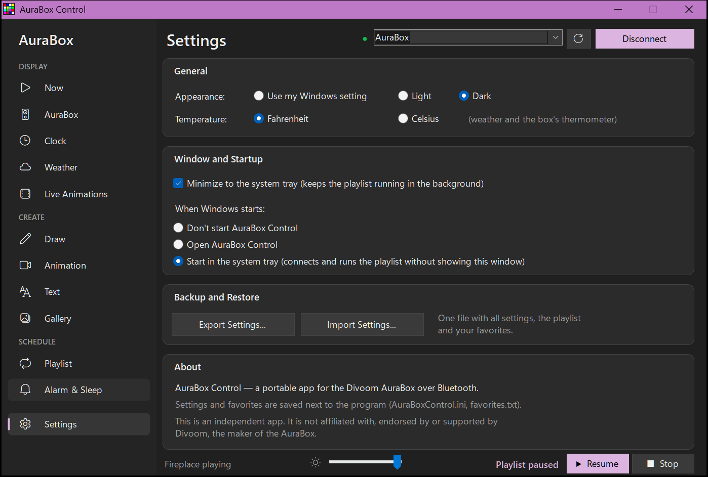

# AuraBox Control

A portable Windows app for the **Divoom AuraBox**, the Bluetooth speaker with a 10×10 LED display. It runs the
display from your PC: clocks, weather, live animations, your own drawings and scrolling text, all in a playlist
that keeps going from the system tray.

> This is an independent project. It is not affiliated with, endorsed by or supported by Divoom, the maker of
> the AuraBox. "Divoom" and "AuraBox" are trademarks of their owner.



## Features

- **Playlist.** Rotate any mix of items, each for its own length of time, and run it from the system tray.
- **Clock.** A steady clock drawn by the app (no blinking colon), or the box's own clock. 12- or 24-hour.
- **Weather.** Current conditions from [Open-Meteo](https://open-meteo.com) (free, no API key). Animated
  icons, with an optional bounce around the screen.
- **Live animations.** These are drawn on the PC frame by frame, so there's no 8-frame limit. Each has its own
  speed setting:
  - Lava Clock: lava gathers into the time, then melts into a puddle.
  - Fireplace, Lava Lamp, Hyperspace, Rain on a Window.
  - Snake Chase, Falling Blocks, Bouncing Balls, Brick Breaker.
  - A waving Laos flag.
- **Create.** A drawing editor, an 8-frame animation editor, an animated GIF importer, and scrolling text in
  any Windows font.
- **Gallery.** Browse the community designs on Divoom's cloud gallery and save favorites.
- **Box controls.**
  - The built-in modes, solid colors and brightness.
  - Audio input: the AUX jack or Bluetooth.
  - Alarm and sleep timer, notification icons, and the temperature unit.
- **Everyday use.**
  - Light and dark themes.
  - Start with Windows, optionally hidden in the tray.
  - Reconnects to the box automatically.
  - Settings backup and restore.

| Animations | Original Modes |
|---|---|
|  |  |



## Requirements

- Windows 10 or 11.
- The .NET Framework 4.x that comes with Windows. Nothing to install.
- An AuraBox paired in Windows Bluetooth settings. It shows up as **AuraBox-audio**; use PIN `0000` if asked.
  The app talks to the box's display over the Bluetooth serial port (SPP).

## Build

No SDK or Visual Studio is needed. The C# compiler is part of Windows:

```cmd
tools\build.cmd
```

This produces `AuraBoxControl.exe` in this folder. It's portable: settings (`AuraBoxControl.ini`) and favorites
(`favorites.txt`) are saved next to it.

| Folder | What's in it |
|---|---|
| `src/` | The C# source, the app icon, and the design lists built into the exe |
| `tools/` | `build.cmd`, and the scripts that make the icon and the design lists |
| `docs/` | Screenshots for this README |
| `dist/` | Release downloads (not committed) |

### Optional: Divoom's built-in designs

The app can show the pictures and animations that come with Divoom's Android app in its Gallery page. They are
Divoom's artwork, so they aren't included in this repository. To add them:

1. Get the AuraBox Android app's APK (`com.cheerchip.aurabox1`) and open it as a zip file.
2. Extract `assets/prepare.db`.
3. Run `python tools/export_gallery.py prepare.db src/gallery.txt`.
4. Run `tools\build.cmd`. It embeds `src/gallery.txt` whenever the file is there.

## Tools

| Script | What it does |
|---|---|
| `tools/export_gallery.py` | Turns the Android app's design database into `src/gallery.txt`. |
| `tools/originals.py` | Prints this project's own designs. `--line` gives the lines used in `src/extras.txt`. |
| `tools/weather_icons.py` | The weather icon art. `--png out.png` saves a preview, and `--cs` prints the C# table used in `src/AuraBoxControl.cs`. |
| `tools/make_icon.ps1` | Draws the app icon at every size Windows uses and writes `src/app.ico`. |

## Protocol notes

The protocol was worked out from the official Android app.

- **Frame layout:** `01 | escaped(len_lo len_hi cmd data… sum_lo sum_hi) | 02`
  - `len` is the data length plus 3. `sum` is the 16-bit sum of the length bytes, the command and the data.
  - Escaping: `01` → `03 04`, `02` → `03 05`, `03` → `03 06`.
- **Pixels:** 3 bits each (red, green, blue), so 8 colors. Two pixels are packed per byte, 50 bytes per frame.
- **Commands:**

  | Byte | Command |
  |---|---|
  | `05` | Audio source (`00` Bluetooth, `02` line-in) |
  | `18` | Set time |
  | `32` | Brightness |
  | `40` / `41` | Sleep |
  | `43` | Alarm |
  | `44` | Picture |
  | `45` | Mode |
  | `47` | Color |
  | `49` | Animation |
  | `4C` | Temperature unit |
  | `50` | Notification |

The cloud gallery uses Divoom's public gallery server, which may change or go away at any time.

## License

[MIT](LICENSE)
