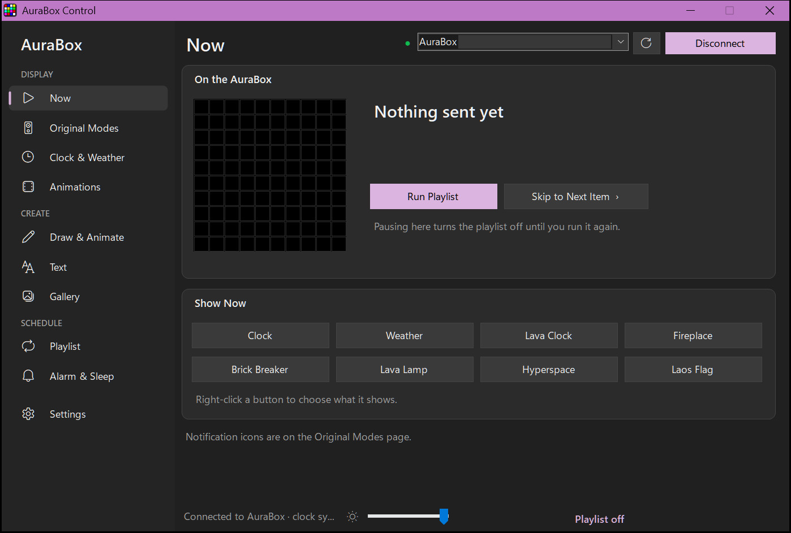
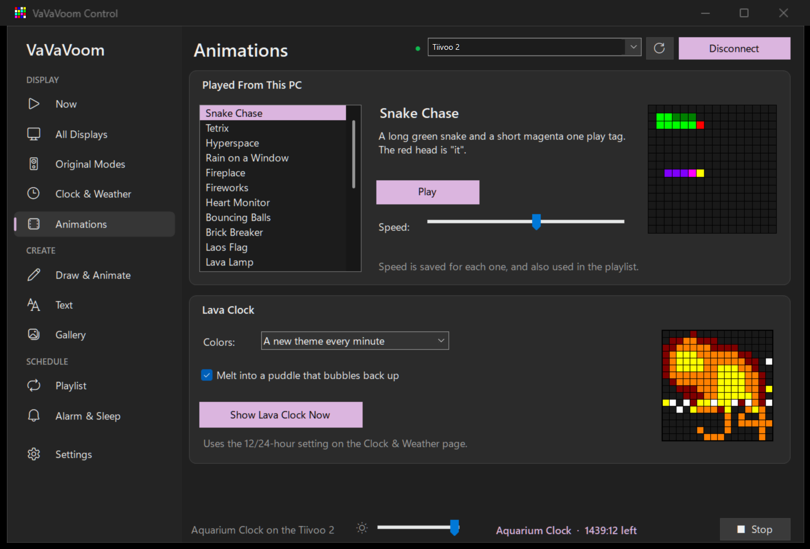
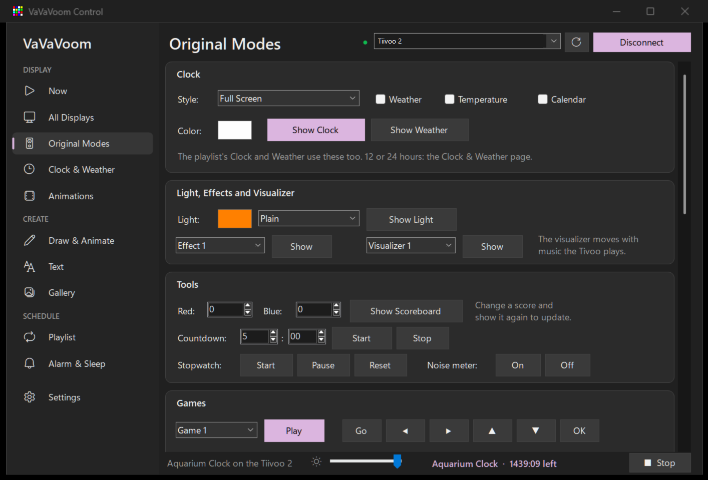
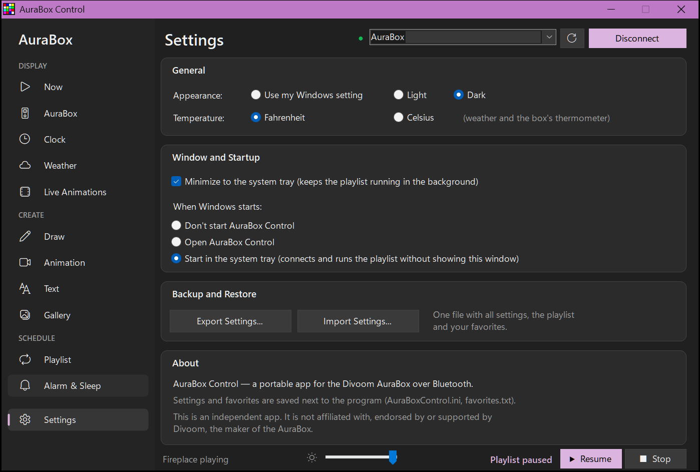

# VaVaVoom Control

A portable Windows app for Divoom's Bluetooth pixel displays: the **AuraBox** (10×10, 8 colors), the
**Tivoo** and **Ditoo Pro** (16×16, full color) and the **Tiivoo 2** (160×128, full color). It runs the displays
from your PC: clocks, weather, live animations, your own drawings and scrolling text, all in a playlist per
display that keeps going from the system tray.

> This is an independent project. It is not affiliated with, endorsed by or supported by Divoom, the maker of
> these displays. "Divoom", "AuraBox", "Tivoo", "Ditoo" and "Tiivoo" are trademarks of their owner.



## Features

- **Two displays at once.** Each connected display has its own playlist; pick one at the top to control it.
- **Playlist.** Rotate any mix of items, each for its own length of time, and run it from the system tray.
  Random Favorite and Holiday Designs (whatever holiday is in season) pick something new each time.
- **Clock.** A steady clock drawn by the app (no blinking colon), or the box's own clock. 12- or 24-hour.
- **Weather.** Current conditions from [Open-Meteo](https://open-meteo.com) (free, no API key). Animated
  icons, with an optional bounce around the screen.
- **Live animations.** These are drawn on the PC frame by frame, so there's no frame limit, at 10×10 or
  16×16 to suit the display. Each has its own speed setting:
  - Lava Clock: lava gathers into the time, then melts into a puddle.
  - Fireplace, Lava Lamp, Hyperspace, Rain on a Window.
  - Mandelbrot Zoom: an endless dive into the Mandelbrot set, smooth-shaded on the Tivoo.
  - Aquarium: fish wander a planted tank with an air bubbler, and chase food flakes now and then.
  - Jellyfish: jellyfish bob in a glowing tank, pulsing their bells and trailing their tentacles.
  - Days to Next Holiday: counts down to the next US holiday, with confetti on the day.
  - Snake Chase, Tetrix, Bouncing Balls, Brick Breaker.
  - Gem Miner: a miner tunnels after gems, zapping glow worms and dropping boulders on them.
  - Star Swarm: a rocket holds off waves of alien saucers, fighters and bombers that dive at it.
  - A waving Laos flag.
- **Create.** A drawing editor, an 8-frame animation editor, an animated GIF importer, and scrolling text in
  any Windows font.
- **Gallery.** Browse Divoom's cloud galleries (16×16 art by topic and by holiday, search, your Divoom likes
  and uploads, older small art, LaMetric icons):
  - Names in English, duplicates hidden, and any design can be renamed.
  - Years drawn in designs are brought up to date ("Happy New Year 2021" shows the coming year).
  - Favorites (10×10 and 16×16) and lists of your own, kept on this PC.
  - Every design you've seen is saved on the PC, so pages open at once and still work offline.
- **Tiivoo 2.** Animations drawn for its full 160×128 screen, which it plays by itself once sent:
  - Aquarium, Heart Monitor (beeping with each beat), Mandelbrot Zoom, a Weather card with photo-style skies
    that flips to tomorrow's forecast, a Retro Robot with a scanning visor, and a Slot Machine with the odd
    jackpot. Sounds play through the Tiivoo 2's own speaker (it's the PC's Bluetooth speaker too).
  - Aquarium Clock: the aquarium as one of the Tiivoo 2's own clock faces, so it keeps the time even with the PC
    off, with a bubbling-water sound. It can also show the weekday and date, and it follows the app's 12/24-hour
    setting.
  - Clock faces from Divoom's clock store (sign in with your Divoom account), including faces with picture
    digits such as Flip Clock.
  - Its tools (stopwatch, countdown, scoreboard, noise meter), a Pomodoro timer, lyrics, white noise, FM radio
    and its SD card and photo album.
  - Gallery designs fill its wide screen, with a glow on the sides, and the Gallery can show animated designs only.
- **Display controls.**
  - The built-in modes, solid colors and brightness. On the Tivoo and Tiivoo 2: their clocks, light, effects,
    stopwatch, countdown, scoreboard, noise meter, games and a color boost for their LEDs.
  - Audio input: the AUX jack or Bluetooth.
  - Alarm and sleep timer, notification icons, and the temperature unit.
- **Everyday use.**
  - Light and dark themes.
  - Start with Windows, optionally hidden in the tray.
  - Reconnects to the box automatically.
  - Settings backup and restore.
  - Command-line options and keyboard shortcuts for the tools (see below), for desktop shortcuts or a Stream Deck.

| Animations | Original Modes (the Tiivoo 2's tools) |
|---|---|
|  |  |



## Requirements

- Windows 10 or 11.
- The .NET Framework 4.x that comes with Windows. Nothing to install.
- An AuraBox, Tivoo, Ditoo Pro or Tiivoo 2 paired in Windows Bluetooth settings. They show up as names like
  **AuraBox-audio**, **Tivoo-audio**, **DitooPro-Audio** and **Divoom Tiivoo 2-Audio**; use PIN `0000` if asked.
  The app talks to the display over the Bluetooth serial port (SPP).
- For Tiivoo 2 clock faces from Divoom's store: a Divoom account (Gallery → Divoom Account). The password is used
  to sign in and isn't saved.

## Command line and keyboard shortcuts

Run `VaVaVoomControl.exe` with these options to control the copy that's already running, without opening its
window. That makes them handy for desktop shortcuts, a Stream Deck or scripts. If VaVaVoom isn't running yet, it
starts and runs them once it's up.

| Option | What it does |
|---|---|
| `--page <name>` | Opens a page by its name in the sidebar, such as `--page Gallery`. |
| `--display <name>` | Picks a display, as its name shows at the top (`--display "Tiivoo 2"`). A `--tool` or `--mode` after it goes to that display. |
| `--mode <animation>` | Plays an animation by its name or id (`--mode "Aquarium Clock"` or `--mode aquaclock`). `--mode playlist` resumes the playlist. |
| `--tool <command>` | Runs a tool on a Tivoo, Ditoo Pro or Tiivoo 2 (the commands are below). |
| `--hide` | Sends the window to the tray. |
| `--tray` | Starts hidden in the tray (used by "start with Windows"). |

Tool commands:

| Command | What it does |
|---|---|
| `score:red+1`, `score:blue-1` | Adds or takes away points and shows the scoreboard. |
| `score:3:2`, `score:reset`, `score:show` | Sets both scores, sets them to 0, or shows the scoreboard as it is. |
| `stopwatch:start`, `pause`, `reset`, `toggle` | The stopwatch. `toggle` starts it, or pauses it if it's running. |
| `countdown:5`, `countdown:2:30`, `countdown:stop` | Starts a countdown (minutes, or minutes:seconds), or stops it. |
| `noise:on`, `noise:off` | The noise meter. |

Without `--display`, a tool goes to the display picked at the top if it has the tools. Otherwise it goes to the
first connected one that does, a Tiivoo 2 first.

For example, a desktop shortcut with the target
`"C:\...\VaVaVoomControl.exe" --display "Tiivoo 2" --tool score:red+1` gives red a point.

These keyboard shortcuts work from any program, even with VaVaVoom in the tray. You can turn them off in the
Tools card on the Original Modes page.

| Keys | What they do |
|---|---|
| Ctrl+Alt+1 / Ctrl+Alt+2 | A point for red / blue |
| Ctrl+Alt+Shift+1 / Ctrl+Alt+Shift+2 | Take a point back from red / blue |
| Ctrl+Alt+0 | Both scores to 0 |
| Ctrl+Alt+S | Start or pause the stopwatch |

## Build

No SDK or Visual Studio is needed. The C# compiler is part of Windows:

```cmd
tools\build.cmd
```

This produces `VaVaVoomControl.exe` in this folder. It's portable: settings (`VaVaVoomControl.ini`), favorites
(`favorites.txt`), your lists (`lists.txt`) and saved Gallery designs (`cache\`) are kept in a `settings` folder
next to it, created on first run.

| Folder | What's in it |
|---|---|
| `src/` | The C# source, the app icon, and the design lists built into the exe |
| `tools/` | `build.cmd`, and the scripts that make the icon and the design lists |
| `docs/` | Screenshots for this README |
| `settings/` | Your settings, favorites, lists and saved designs (made by the app, not committed) |
| `dist/` | Release downloads (not committed) |

### Optional: Divoom's built-in designs

The app can show the pictures and animations that come with Divoom's Android app in its Gallery page. They are
Divoom's artwork, so they aren't included in this repository. To add them:

1. Get the AuraBox Android app's APK (`com.cheerchip.aurabox1`) and open it as a zip file.
2. Extract `assets/prepare.db`.
3. Run `python tools/export_gallery.py prepare.db src/gallery.txt`.
4. Run `tools\build.cmd`. It embeds `src/gallery.txt` whenever the file is there.

### Optional: photos for the Tiivoo 2's aquarium

On the Tiivoo 2, the Aquarium and Aquarium Clock can use your own photos instead of drawn fish. Put cut-out
pictures in a folder named `Aquarium` next to `VaVaVoomControl.exe`:

| File | What it is | Shown about |
|---|---|---|
| `clownfish.png` | A clownfish, facing right. Used twice: a big one and a small one following it. | 50 px wide |
| `blue_tang.png` | A blue tang (or any fish), facing right. | 64 px wide |
| `starfish.png` | A starfish seen from the front; it creeps over the glass and now and then one arm lets go. | 34 px wide |
| `pirate_wheel.png` | A skeleton ornament at a ship's wheel, standing on the gravel. The wheel turns and the skeleton leans at set places in the picture, so a different ornament may move oddly. | 46 px wide |
| `plants.png` | A clump of plants, standing on its bottom edge; it sways. | 88 px wide |

- Use PNG files with a transparent background (cut out, nothing around the subject). Any size works: each is
  shrunk to the width above, so a few hundred pixels across is plenty.
- The fish need both `clownfish.png` and `blue_tang.png`; without them the tank has its drawn fish. Each of the
  others is left out when its file isn't there.
- The pictures are read when the aquarium first plays, so restart VaVaVoom after adding or changing them. For the
  Aquarium Clock, delete `settings\cache\aquarium_clock_*.bin` too, so its picture is made again.
- Only use photos you have the right to use. The folder isn't part of this repository.

## Tools

| Script | What it does |
|---|---|
| `tools/export_gallery.py` | Turns the Android app's design database into `src/gallery.txt`. |
| `tools/originals.py` | Prints this project's own designs. `--line` gives the lines used in `src/extras.txt`. |
| `tools/weather_icons.py` | The weather icon art. `--png out.png` saves a preview, and `--cs` prints the C# table used in `src/AuraBoxControl.cs`. |
| `tools/make_icon.ps1` | Draws the app icon at every size Windows uses and writes `src/app.ico`. |

## Protocol notes

The protocol was worked out from the official Android app.

- **Frame layout:** `01 | escaped(len_lo len_hi cmd data… sum_lo sum_hi) | 02`
  - `len` is the data length plus 3. `sum` is the 16-bit sum of the length bytes, the command and the data.
  - Escaping: `01` → `03 04`, `02` → `03 05`, `03` → `03 06`.
- **Pixels:** 3 bits each (red, green, blue), so 8 colors. Two pixels are packed per byte, 50 bytes per frame.
- **Commands:**

  | Byte | Command |
  |---|---|
  | `05` | Audio source (`00` Bluetooth, `02` line-in) |
  | `18` | Set time |
  | `32` | Brightness |
  | `40` / `41` | Sleep |
  | `43` | Alarm |
  | `44` | Picture |
  | `45` | Mode |
  | `47` | Color |
  | `49` | Animation |
  | `4C` | Temperature unit |
  | `50` | Notification |

The Tivoo uses Divoom's newer framing: `01 | len_lo len_hi cmd data… sum_lo sum_hi | 02` with no escaping, and
full-color pictures (`44`) and animations (`49`) as a color table plus packed color numbers.

The Tiivoo 2 uses the same framing and also takes JSON commands (command `01`). Its full-screen animations are
sent as JPEG frames in one upload (`8B`), and it plays them on a loop. Its clock faces are fetched by the device
through the app (`BD`/`BE` requests), which VaVaVoom answers from Divoom's clock store, or with faces made on
the PC such as the Aquarium Clock.

The cloud galleries use Divoom's public servers, and English names use an unofficial Google translation address;
either may change or go away at any time.

## License

[MIT](LICENSE)
